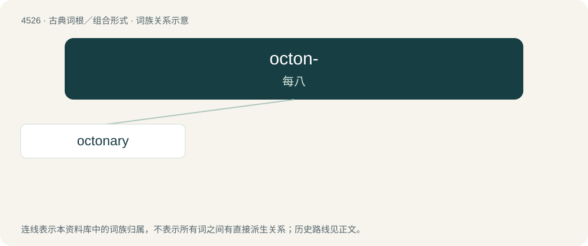

# 4526 · octon- — 每八

[总目录](../00_总目录_按常用程度.md)

**类型**：古典词根／组合形式　｜　**来源语言**：拉丁语

## 核心含义与来源

- 核心含义：每八
- 英文含义：eight each
- 词形：octon-

**来源词形**：octoni

## 词族图

## 单词速览（常用到不常用）

| 单词 | 音标 | 释义 |
|---|---|---|
| [octonary](#w-1) | /ˈɒktənəri/ | a. 八的, 由八组成的, 八进制的；n. 八个一组, 八行诗；\[计\] 八进制的 |

## 逐词详解

### 1. octonary

**词性**：形容词　｜　**音标**：/ˈɒktənəri/

**中文释义**：a. 八的, 由八组成的, 八进制的；n. 八个一组, 八行诗；\[计\] 八进制的

**英文义项**：Of eighth rank or order. / Consisting of eight things

**词源与演化**：

From the Latin octōnārius (“containing eight”), from octōnī (“eight at a time”, “by eights”, “eight each”) + -ārius (whence the English suffix -ary). Doublet of octonarius.
