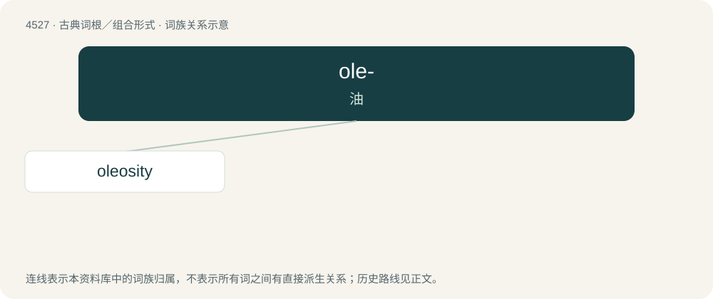

# 4527 · ole- — 油

[总目录](../00_总目录_按常用程度.md)

**类型**：古典词根／组合形式　｜　**来源语言**：拉丁语

## 核心含义与来源

- 核心含义：油
- 英文含义：oil
- 词形：ole-

**来源词形**：oleum

## 词族图

## 单词速览（常用到不常用）

| 单词 | 音标 | 释义 |
|---|---|---|
| [oleosity](#w-1) |  | 【英文】The state or quality of being oily or fat; fatness. |

## 逐词详解

### 1. oleosity

**词性**：名词

**英文义项**：The state or quality of being oily or fat; fatness.
