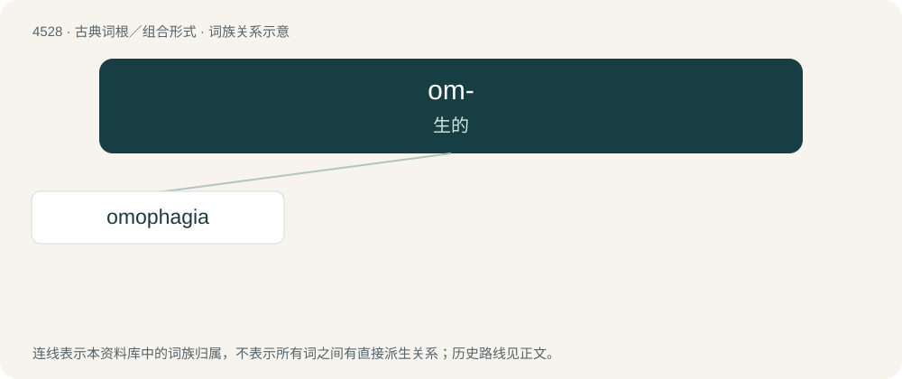

# 4528 · om- — 生的

[总目录](../00_总目录_按常用程度.md)

**类型**：古典词根／组合形式　｜　**来源语言**：古希腊语

## 核心含义与来源

- 核心含义：生的
- 英文含义：raw
- 词形：om-

**来源词形**：ὠμός (ōmós), ὠμότης (ōmótēs) "rawness"

## 词族图

## 单词速览（常用到不常用）

| 单词 | 音标 | 释义 |
|---|---|---|
| [omophagia](#w-1) | /əʊməˈfeɪd͡ʒɪə/ | n. (尤指肉的)生食 |

## 逐词详解

### 1. omophagia

**词性**：名词　｜　**音标**：/əʊməˈfeɪd͡ʒɪə/

**中文释义**：n. (尤指肉的)生食

**英文义项**：The eating of raw food, especially raw flesh.

**词源与演化**：

From Ancient Greek ὠμοφαγία (ōmophagía), from ὠμός (ōmós, “raw”) (see omo-) + -φαγία (-phagía) (see -phagia for more). By surface analysis, omo- (“raw, uncooked”) + -phagia.

## 其他候选词

- Omophagus
