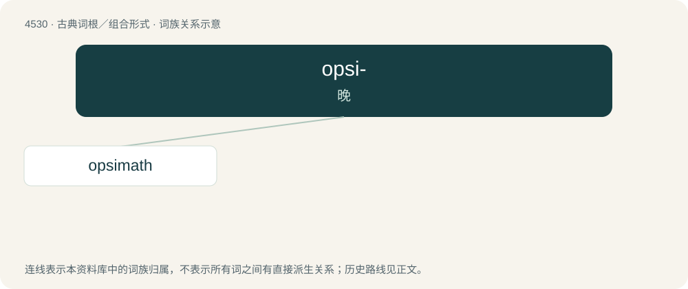

# 4530 · opsi- — 晚

[总目录](../00_总目录_按常用程度.md)

**类型**：古典词根／组合形式　｜　**来源语言**：古希腊语

## 核心含义与来源

- 核心含义：晚
- 英文含义：late
- 词形：opsi-

**来源词形**：ὀψέ (opsé), ὄψιος

## 词族图

## 单词速览（常用到不常用）

| 单词 | 音标 | 释义 |
|---|---|---|
| [opsimath](#w-1) | 英 /ˈɒpsɪmæθ/；美 /ˈɑpsɪmæθ/ | n. 晚年开始学习的人 |

## 逐词详解

### 1. opsimath

**词性**：名词　｜　**音标**：英 /ˈɒpsɪmæθ/；美 /ˈɑpsɪmæθ/

**中文释义**：n. 晚年开始学习的人

**英文义项**：A person who learns late in life.

**词源与演化**：

From the Ancient Greek ὀψιμαθής (opsimathḗs, “late in learning”), ultimately from ὀψέ (opsé, “late”) and μανθάνω (manthánō, “I learn”); compare opsimathy, philomath, and polymath. First appears c. 1808 in The Gentleman's Magazine.
