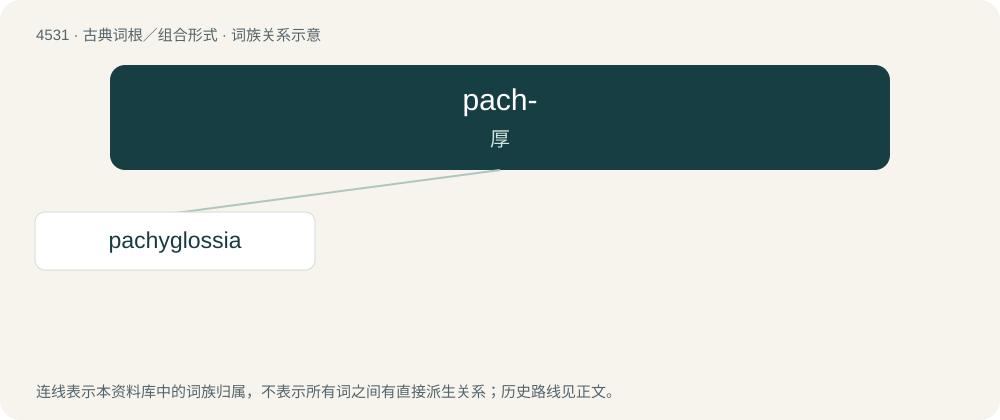

# 4531 · pach- — 厚

[总目录](../00_总目录_按常用程度.md)

**类型**：古典词根／组合形式　｜　**来源语言**：古希腊语

## 核心含义与来源

- 核心含义：厚
- 英文含义：thick
- 词形：pach-

**来源词形**：παχύς (pakhús), πάχος, πάχεος (pákhos, pákheos)

## 词族图

## 单词速览（常用到不常用）

| 单词 | 音标 | 释义 |
|---|---|---|
| [pachyglossia](#w-1) | /pækiˈ^lɔsiə/ | \[医、动\]厚舌 |

## 逐词详解

### 1. pachyglossia

**词性**：名词　｜　**音标**：/pækiˈ^lɔsiə/

**中文释义**：\[医、动\]厚舌

**英文义项**：An abnormal thickening of the tongue.

**构词拆分**：pachy- + -glossia

**词源与演化**：

From pachy- + -glossia.

## 其他候选词

- pachydermata
- pachynsis
- Pachypodium
