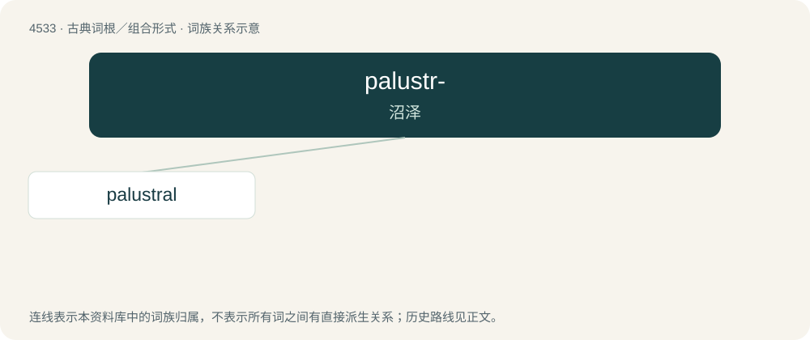

# 4533 · palustr- — 沼泽

[总目录](../00_总目录_按常用程度.md)

**类型**：古典词根／组合形式　｜　**来源语言**：拉丁语

## 核心含义与来源

- 核心含义：沼泽
- 英文含义：in marshes
- 词形：palustr-

**来源词形**：paluster

## 词族图

## 单词速览（常用到不常用）

| 单词 | 音标 | 释义 |
|---|---|---|
| [palustral](#w-1) | /pəˈlʌstɹəl/ | a. 沼泽的, (鸟等)沼栖的, 沼生的 |

## 逐词详解

### 1. palustral

**词性**：形容词　｜　**音标**：/pəˈlʌstɹəl/

**中文释义**：a. 沼泽的, (鸟等)沼栖的, 沼生的

**英文义项**：Pertaining to or located in marshes; marshy. / That requires a marshy habitat.

**词源与演化**：

From Latin palustris, from palūs (“swamp”), -al.
