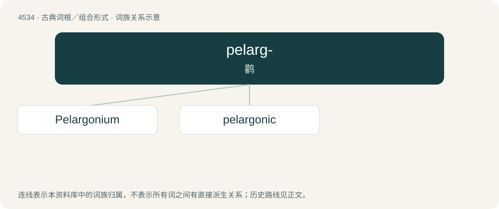

# 4534 · pelarg- — 鹳

[总目录](../00_总目录_按常用程度.md)

**类型**：古典词根／组合形式　｜　**来源语言**：古希腊语

## 核心含义与来源

- 核心含义：鹳
- 英文含义：stork
- 词形：pelarg-

**来源词形**：πελαργός (pelargós), πελαργώδης

## 词族图

## 单词速览（常用到不常用）

| 单词 | 音标 | 释义 |
|---|---|---|
| [Pelargonium](#w-1) | /.peləˈgəuniəm/ | n. 天竺葵 |
| [pelargonic](#w-2) |  | \[医\]壬酸 |

## 逐词详解

### 1. Pelargonium

**词性**：名词　｜　**音标**：/.peləˈgəuniəm/

**中文释义**：n. 天竺葵

**英文义项**：an extract of the rose geranium, Pelargonium sidoides, used as an alternative medicine

### 2. pelargonic

**词性**：形容词

**中文释义**：\[医\]壬酸

**英文义项**：Of or pertaining to plants of the genus Pelargonium. / Of or pertaining to pelargonic acid or its derivatives.

**词源与演化**：

From New Latin Pelargonium (“geranium”) + -ic.
