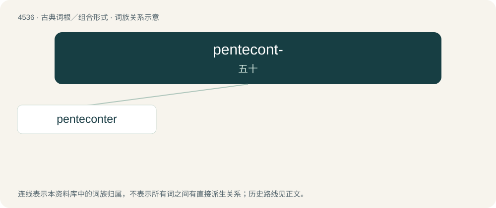

# 4536 · pentecont- — 五十

[总目录](../00_总目录_按常用程度.md)

**类型**：古典词根／组合形式　｜　**来源语言**：古希腊语

## 核心含义与来源

- 核心含义：五十
- 英文含义：fifty
- 词形：pentecont-

**来源词形**：πεντήκοντα (pentḗkonta), πεντηκοντάς, πεντηκοντάδος (pentēkontás, pentēkontádos)

## 词族图

## 单词速览（常用到不常用）

| 单词 | 音标 | 释义 |
|---|---|---|
| [penteconter](#w-1) | /ˈpentkəntər/ | （古希腊的）一种桨帆并用的战舰 |

## 逐词详解

### 1. penteconter

**词性**：名词　｜　**音标**：/ˈpentkəntər/

**中文释义**：（古希腊的）一种桨帆并用的战舰

**英文义项**：A galley-type Grecian vessel with fifty oars.

**词源与演化**：

Borrowed from Ancient Greek πεντηκόντορος (pentēkóntoros, literally “fifty-oared”).

## 其他候选词

- pentecontad
- pentecontagon
