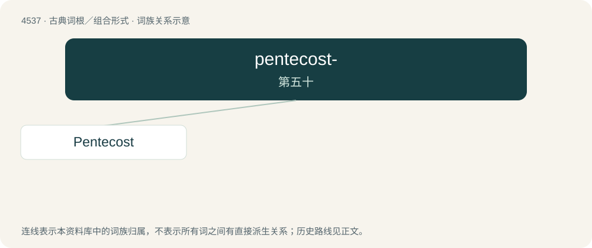

# 4537 · pentecost- — 第五十

[总目录](../00_总目录_按常用程度.md)

**类型**：古典词根／组合形式　｜　**来源语言**：古希腊语

## 核心含义与来源

- 核心含义：第五十
- 英文含义：fiftieth
- 词形：pentecost-

**来源词形**：πεντηκοστός (pentēkostós)

## 词族图

## 单词速览（常用到不常用）

| 单词 | 音标 | 释义 |
|---|---|---|
| [Pentecost](#w-1) | 英 /ˈpɛntɪkɒst/；美 /ˈpɛntəˌkɔst/ | n. 圣灵降临节 |

## 逐词详解

### 1. Pentecost

**词性**：专有名词　｜　**音标**：英 /ˈpɛntɪkɒst/；美 /ˈpɛntəˌkɔst/

**中文释义**：n. 圣灵降临节

**英文义项**：Synonym of Shavuot (“a Jewish harvest festival which falls on the sixth day of Sivan in the spring, fifty days after the second day of the Passover when the omer (“sheaf of barley”) is offered; a ceremony held on that day to commemorate the giving of the Torah (“first five books of the Hebrew scriptures”) to Moses and the Israelites on Mount Sinai”). / A festival which falls on the seventh Sunday after Easter which commemorates the event described in Acts 2 of the Bible when the Holy Spirit descended upon the Apostles during the Jewish festival of Pentecost (proper noun sense 1), conferring on them the miraculous ability to explain the gospel in languages they did not know; also, the Sunday on which the festival is celebrated.

**词源与演化**：

From Middle English Pentecoste (“feast of the descent of the Holy Spirit, Pentecost; season of Pentecost, Whitsuntide; Jewish festival celebrating giving of the law to Moses”), from Old English Pentecosten, also influenced by Anglo-Norman pentecoste, Middle French pentecoste, and Old French pentecoste (“Christian feast of Pentecost; Jewish festival of Pentecost”) (modern French Pentecôte). Both the Old English and Old French words are derived from Ecclesiastical Latin Pentēcostē (“Christian feast of Pentecost; Jewish festival of Pentecost”), from Koine Greek πεντηκοστή (pentēkostḗ, “Christian feast of Pentecost; Jewish festival of Pentecost”), from Ancient Greek πεντηκοστή (pentēkostḗ, “fiftieth”), a noun use of the feminine form of πεντηκοστὸς (pentēkostòs, “fiftieth”, adjective), short for πεντηκοστὸς ἡμέρα (pentēkostòs hēméra, “fiftieth day”) (referring to the Jewish festival falling on the fiftieth day after the second day of the Passover), used in the Bible to translate Hebrew שָׁבוּעוֹת (shāvū'ót, “weeks”). Πεντηκοστὸς (Pentēkostòs) is derived from Proto-Hellenic \*penkʷēkontstós, from \*pénkʷe (“five”) (from Proto-Indo-European \*pénkʷe (“five; hand”)) + \*-kontstós (suffix forming ordinal numbers from twentieth to ninetieth) (whence ; from Proto-Indo-European \*déḱm̥ (“ten”)). The surname is from Old French and Middle English Pentecost, a personal name perhaps given to one born on Pentecost; also an altered form of Pankhurst. Compare Pancoast. Compare also Pinkster, a cognate borrowed from Dutch sometimes used regionally or archaically.

## 其他候选词

- pentecostalism
