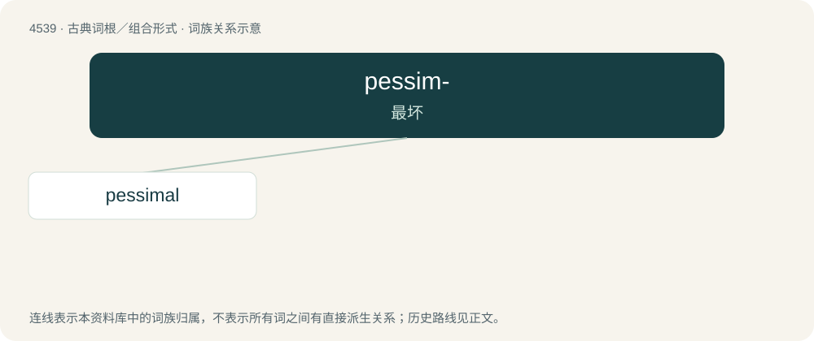

# 4539 · pessim- — 最坏

[总目录](../00_总目录_按常用程度.md)

**类型**：古典词根／组合形式　｜　**来源语言**：拉丁语

## 核心含义与来源

- 核心含义：最坏
- 英文含义：worst
- 词形：pessim-

**来源词形**：pessimus

## 词族图

## 单词速览（常用到不常用）

| 单词 | 音标 | 释义 |
|---|---|---|
| [pessimal](#w-1) | /ˈpɛ.sɪ.məl/ | a. (环境等)最坏的,最差的 |

## 逐词详解

### 1. pessimal

**词性**：形容词　｜　**音标**：/ˈpɛ.sɪ.məl/

**中文释义**：a. (环境等)最坏的,最差的

**英文义项**：Bad to a maximal extent; worst.

**构词拆分**：Latin pessimus (“worst”) + -al

**词源与演化**：

From Latin pessimus (“worst”) + -al, modeled on optimal.
