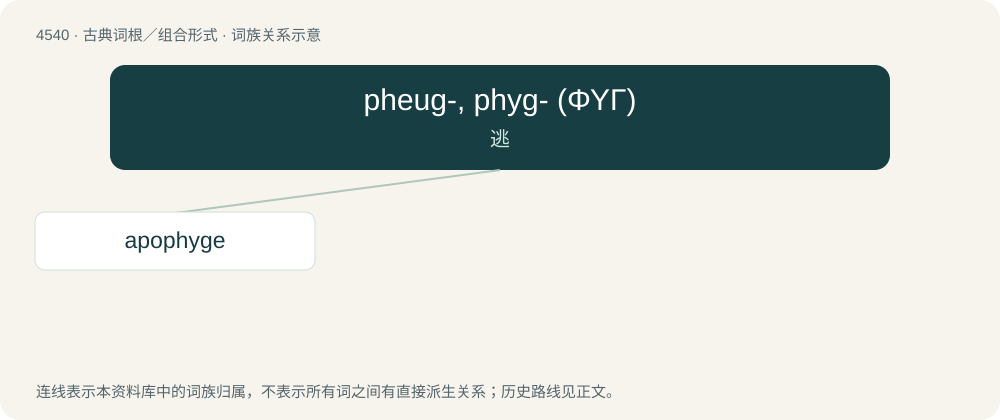

# 4540 · pheug-, phyg- (ΦΥΓ) — 逃

[总目录](../00_总目录_按常用程度.md)

**类型**：古典词根／组合形式　｜　**来源语言**：古希腊语

## 核心含义与来源

- 核心含义：逃
- 英文含义：flee
- 词形：pheug-, phyg-

**来源词形**：φεύγειν (pheúgein), φυγή, φυγάς, φυγάδος (phugás, phugádos) "fugitive", φυγαδικός

## 词族图

## 单词速览（常用到不常用）

| 单词 | 音标 | 释义 |
|---|---|---|
| [apophyge](#w-1) | /əˈpɔfidʒiː/ | n. \[建\]蜗牛形柱墩, 柱身之凹 |

## 逐词详解

### 1. apophyge

**词性**：名词　｜　**音标**：/əˈpɔfidʒiː/

**中文释义**：n. \[建\]蜗牛形柱墩, 柱身之凹

**英文义项**：A curvature found on the top or bottom of certain columns.

**词源与演化**：

From Ancient Greek ἀποφυγή (apophugḗ), from ἀπο- (apo-, “away”) and φυγή (phugḗ, “flight”).

## 其他候选词

- hypophyge
