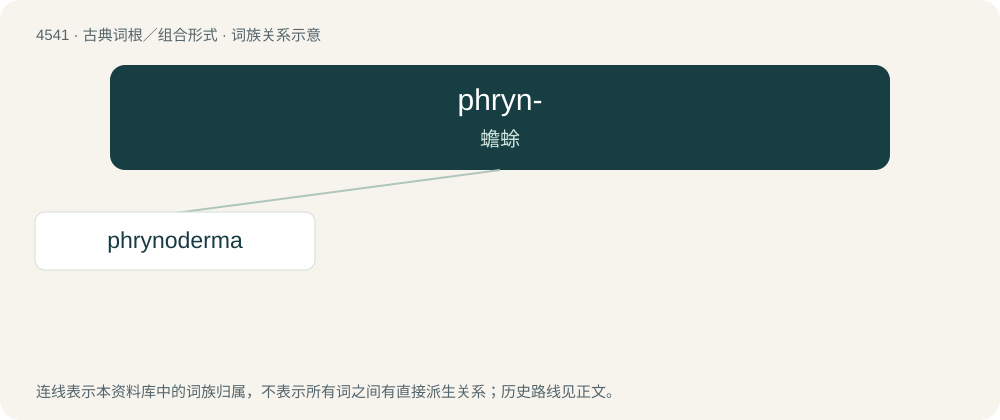

# 4541 · phryn- — 蟾蜍

[总目录](../00_总目录_按常用程度.md)

**类型**：古典词根／组合形式　｜　**来源语言**：古希腊语

## 核心含义与来源

- 核心含义：蟾蜍
- 英文含义：toad, toad-like
- 词形：phryn-

**来源词形**：φρύνη (phrúnē)

## 词族图

## 单词速览（常用到不常用）

| 单词 | 音标 | 释义 |
|---|---|---|
| [phrynoderma](#w-1) | /,frainəˈdəːmə/ | 蟾皮病 |

## 逐词详解

### 1. phrynoderma

**词性**：名词　｜　**音标**：/,frainəˈdəːmə/

**中文释义**：蟾皮病

**英文义项**：hypovitaminosis A, seen as rough, hyperkeratotic, follicular papules on the skin

**词源与演化**：

Ancient Greek φρῡ́νη (phrū́nē, “toad”) + -derma.

## 其他候选词

- Phrynobatrachus
