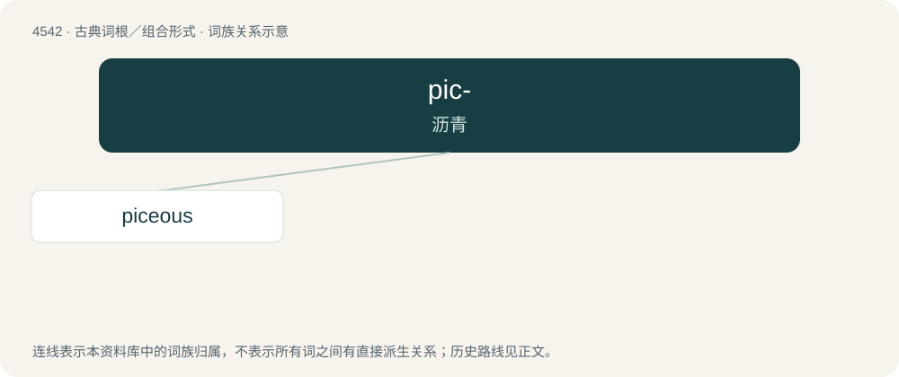

# 4542 · pic- — 沥青

[总目录](../00_总目录_按常用程度.md)

**类型**：古典词根／组合形式　｜　**来源语言**：拉丁语

## 核心含义与来源

- 核心含义：沥青
- 英文含义：pitch
- 词形：pic-

**来源词形**：pix, picis

## 词族图

## 单词速览（常用到不常用）

| 单词 | 音标 | 释义 |
|---|---|---|
| [piceous](#w-1) | 英 /ˈpɪ.sɪ.əs/；美 /ˈpɪ.si.əs/ | (似)沥青的, 沥青色的(尤指动物) |

## 逐词详解

### 1. piceous

**词性**：形容词　｜　**音标**：英 /ˈpɪ.sɪ.əs/；美 /ˈpɪ.si.əs/

**中文释义**：(似)沥青的, 沥青色的(尤指动物)

**英文义项**：Of or pertaining to pitch (“a sticky, dark brown substance obtained from distilling turpentine or wood tar, or crude oil or tar”); having a quality like pitch. / Resembling pitch in colour; a very dark brown.

**词源与演化**：

From Latin piceus (“like pitch; pitch-black”) + -ous (suffix forming adjectives denoting possession or presence of a quality). Piceus is derived from pix (“pitch, tar”) (ultimately from Proto-Indo-European \*peyH- (“fat; milk”)) + -eus (suffix forming adjectives indicating the sources of attributes). The English word is cognate with Italian piceo (“like pitch; of a dark brown colour”), Spanish piceo (“like pitch; of a dark brown colour”).
