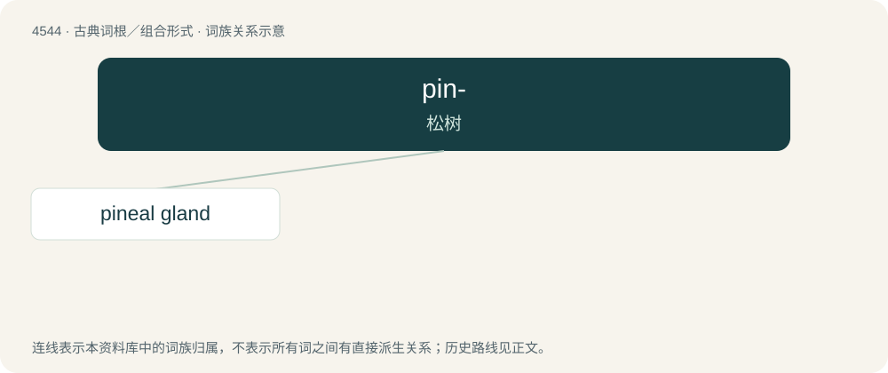

# 4544 · pin- — 松树

[总目录](../00_总目录_按常用程度.md)

**类型**：古典词根／组合形式　｜　**来源语言**：拉丁语

## 核心含义与来源

- 核心含义：松树
- 英文含义：pine
- 词形：pin-

**来源词形**：pinus

## 词族图

## 单词速览（常用到不常用）

| 单词 | 音标 | 释义 |
|---|---|---|
| [pineal gland](#w-1) | 英 /ˈpaɪ.niːəl ˌɡlænd/ | \[化\] 松果腺 |

## 逐词详解

### 1. pineal gland

**词性**：名词　｜　**音标**：英 /ˈpaɪ.niːəl ˌɡlænd/

**中文释义**：\[化\] 松果腺

**英文义项**：A small, pinecone-shaped endocrine gland found near the centre of the brain that produces melatonin.

**构词拆分**：pineal + gland

**词源与演化**：

From pineal + gland, from its pine-cone shape.
