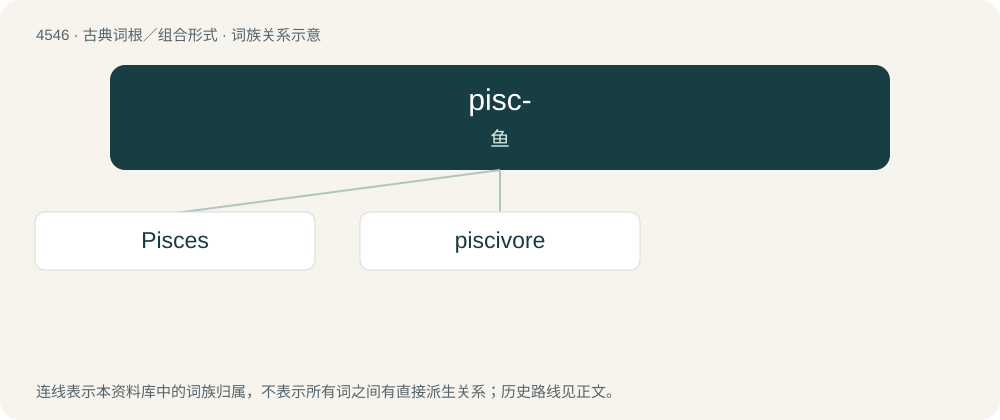

# 4546 · pisc- — 鱼

[总目录](../00_总目录_按常用程度.md)

**类型**：古典词根／组合形式　｜　**来源语言**：拉丁语

## 核心含义与来源

- 核心含义：鱼
- 英文含义：fish
- 词形：pisc-

**来源词形**：piscis

## 词族图

## 单词速览（常用到不常用）

| 单词 | 音标 | 释义 |
|---|---|---|
| [Pisces](#w-1) | /ˈpaɪsiːz/ | \[医\] 鱼类 |
| [piscivore](#w-2) | 英 /ˈpɪs(k)ɪvɔː/；美 /ˈpɪsɪvɔɹ/ | 食鱼动物 |

## 逐词详解

### 1. Pisces

**词性**：名词　｜　**音标**：/ˈpaɪsiːz/

**中文释义**：\[医\] 鱼类

**英文义项**：Someone with a Pisces astrological sign.

**词源与演化**：

From Latin piscēs, the nominative plural of piscis (“fish”), calque of Ancient Greek ἰχθύες (ikhthúes, “fish (pl); name of constellation”). Compare Akkadian 𒁺𒉺𒉺 (DU.NU.NU, “fish-cord”); the constellation is often depicted as two fish tied by a ribbon.

**例句**：

> Do you think a male Gemini would get on well with a female Pisces?

### 2. piscivore

**词性**：名词　｜　**音标**：英 /ˈpɪs(k)ɪvɔː/；美 /ˈpɪsɪvɔɹ/

**中文释义**：食鱼动物

**英文义项**：A fish eater.

**构词拆分**：pisci- + -vore

**词源与演化**：

From pisci- (“fish”) + -vore (“eater”).
