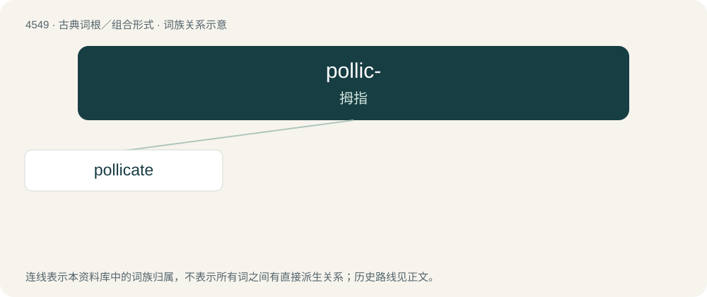

# 4549 · pollic- — 拇指

[总目录](../00_总目录_按常用程度.md)

**类型**：古典词根／组合形式　｜　**来源语言**：拉丁语

## 核心含义与来源

- 核心含义：拇指
- 英文含义：thumb
- 词形：pollic-

**来源词形**：pollex, pollicis

## 词族图

## 单词速览（常用到不常用）

| 单词 | 音标 | 释义 |
|---|---|---|
| [pollicate](#w-1) | /ˈpɒlɪkeɪt/ | \[医\]具曲刺的 |

## 逐词详解

### 1. pollicate

**词性**：动词　｜　**音标**：/ˈpɒlɪkeɪt/

**中文释义**：\[医\]具曲刺的

**英文义项**：To gesture with the thumb.

**词源与演化**：

From Latin pollex (“thumb, big toe”).
