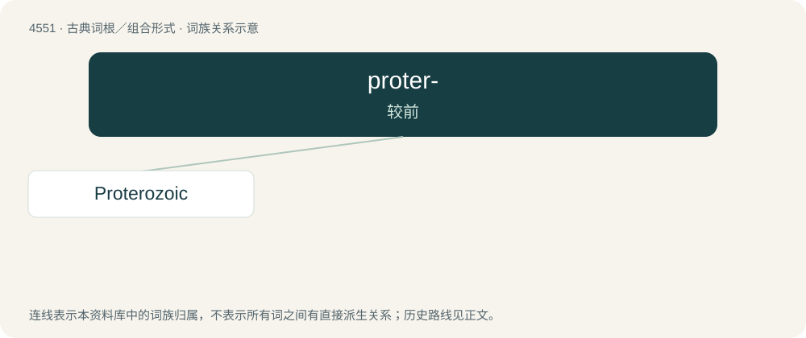

# 4551 · proter- — 较前

[总目录](../00_总目录_按常用程度.md)

**类型**：古典词根／组合形式　｜　**来源语言**：古希腊语

## 核心含义与来源

- 核心含义：较前
- 英文含义：former
- 词形：proter-

**来源词形**：πρό (pró), πρότερος (próteros), προτερέω

## 词族图

## 单词速览（常用到不常用）

| 单词 | 音标 | 释义 |
|---|---|---|
| [Proterozoic](#w-1) | 英 /ˌpɹɒt(ə)ɹəˈzəʊɪk/；美 /ˌpɹoʊt(ə)ɹrəˈzoʊɪk/ | n. 元古代, 元古代岩；a. 元古代的, 元古代岩的 |

## 逐词详解

### 1. Proterozoic

**词性**：形容词　｜　**音标**：英 /ˌpɹɒt(ə)ɹəˈzəʊɪk/；美 /ˌpɹoʊt(ə)ɹrəˈzoʊɪk/

**中文释义**：n. 元古代, 元古代岩；a. 元古代的, 元古代岩的

**英文义项**：Of or relating to the geologic eon from 2,500 Ma to 541.0±1.0 Ma.

**构词拆分**：protero- + -zoic

**词源与演化**：

From protero- + -zoic.
