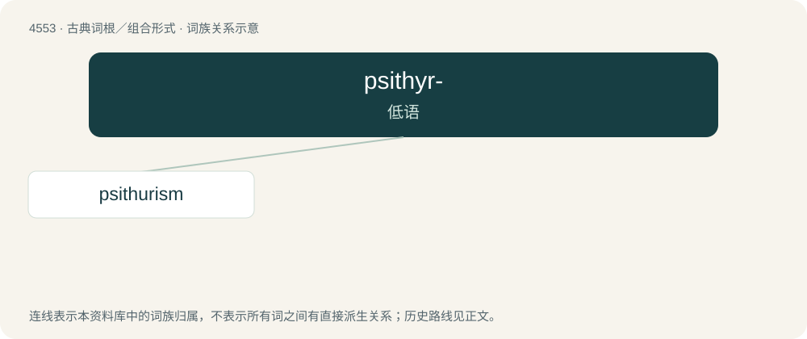

# 4553 · psithyr- — 低语

[总目录](../00_总目录_按常用程度.md)

**类型**：古典词根／组合形式　｜　**来源语言**：古希腊语

## 核心含义与来源

- 核心含义：低语
- 英文含义：whisper
- 词形：psithyr-

**来源词形**：ψίθυρος, ψιθυρίζω, ψιθυρισμός

## 词族图

## 单词速览（常用到不常用）

| 单词 | 音标 | 释义 |
|---|---|---|
| [psithurism](#w-1) | /ˈsɪθjʊəˌɹɪzəm/ | 【英文】The sound of rustling leaves or wind in the trees. |

## 逐词详解

### 1. psithurism

**词性**：名词　｜　**音标**：/ˈsɪθjʊəˌɹɪzəm/

**英文义项**：The sound of rustling leaves or wind in the trees.

**词源与演化**：

An adaptation of the Ancient Greek ψιθύρισμα (psithúrisma) or ψιθυρισμός (psithurismós), from ψιθυρίζω (psithurízō, “I whisper”), from ψίθυρος (psíthuros, “whispering, slanderous”).

## 其他候选词

- Psithyrisma
