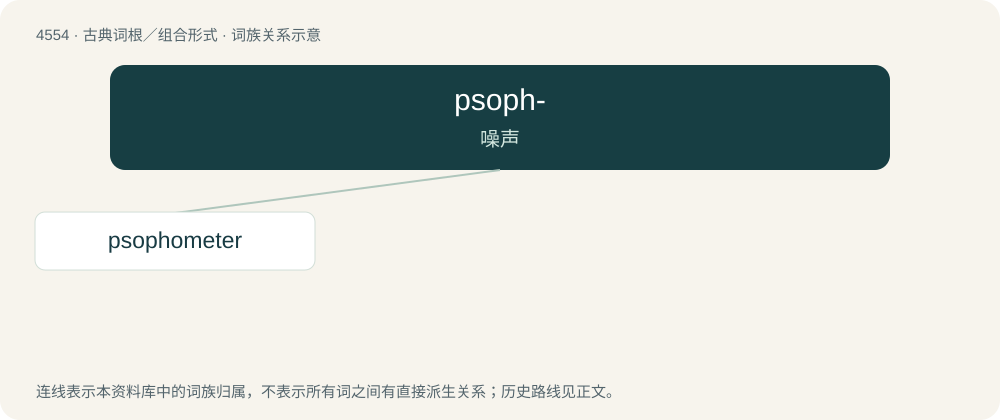

# 4554 · psoph- — 噪声

[总目录](../00_总目录_按常用程度.md)

**类型**：古典词根／组合形式　｜　**来源语言**：古希腊语

## 核心含义与来源

- 核心含义：噪声
- 英文含义：noise
- 词形：psoph-

**来源词形**：ψόφος (psóphos), ψοφεῖν, ψοφητικός, ψόφησις, ψόφημα, ψοφοειδής

## 词族图

## 单词速览（常用到不常用）

| 单词 | 音标 | 释义 |
|---|---|---|
| [psophometer](#w-1) | /səʊˈfɒmɪtə(ɹ)/ | n. 噪声计 |

## 逐词详解

### 1. psophometer

**词性**：名词　｜　**音标**：/səʊˈfɒmɪtə(ɹ)/

**中文释义**：n. 噪声计

**英文义项**：An instrument used in telecommunications to measure the noise of a telephone circuit.

## 其他候选词

- Psophiidae
- Psophocichla
- psophometric
