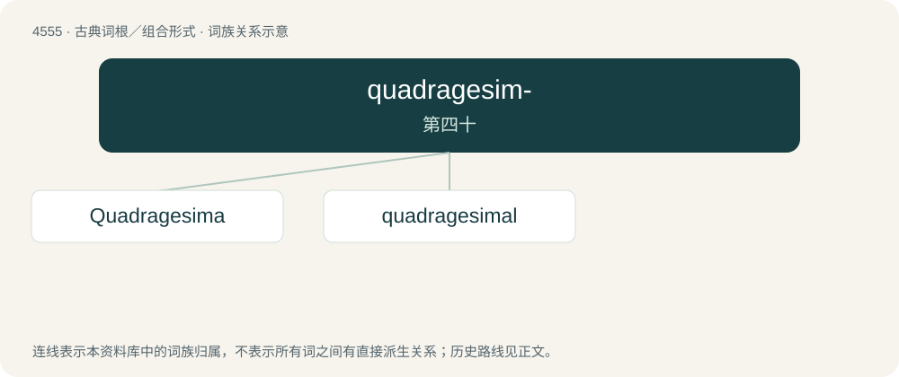

# 4555 · quadragesim- — 第四十

[总目录](../00_总目录_按常用程度.md)

**类型**：古典词根／组合形式　｜　**来源语言**：拉丁语

## 核心含义与来源

- 核心含义：第四十
- 英文含义：fortieth
- 词形：quadragesim-

**来源词形**：quadragesimus

## 词族图

## 单词速览（常用到不常用）

| 单词 | 音标 | 释义 |
|---|---|---|
| [Quadragesima](#w-1) | /ˌkwɒdɹəˈdʒɛsɪmə/ | n. 四旬节(四旬斋的第一个星期日) |
| [quadragesimal](#w-2) | /,kwɒdrəˈdʒesɪm(ə)l/ | a. 四旬斋的, (适于)四旬斋节的; \[q-\]由四十组成的, (尤指四旬斋期等)延续四十天的 |

## 逐词详解

### 1. Quadragesima

**词性**：专有名词　｜　**音标**：/ˌkwɒdɹəˈdʒɛsɪmə/

**中文释义**：n. 四旬节(四旬斋的第一个星期日)

**英文义项**：Synonym of Lent. / Synonym of Quadragesima Sunday: the first Sunday in Lent.

**词源与演化**：

From Latin Quadrāgēsima (“Lent”), from feminine substantive use of quadrāgēsimus (“fortieth”), from the 40 days between Ash Wednesday and Easter using inclusive counting and excluding Sundays.

### 2. quadragesimal

**词性**：形容词　｜　**音标**：/,kwɒdrəˈdʒesɪm(ə)l/

**中文释义**：a. 四旬斋的, (适于)四旬斋节的; \[q-\]由四十组成的, (尤指四旬斋期等)延续四十天的

**英文义项**：That lasts forty days / Belonging to Lent; used in Lent; Lenten

**构词拆分**：Quadragesima + -al

**词源与演化**：

From Quadragesima + -al.
