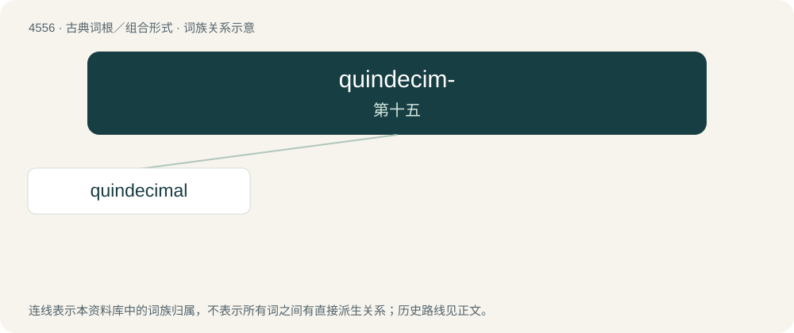

# 4556 · quindecim- — 第十五

[总目录](../00_总目录_按常用程度.md)

**类型**：古典词根／组合形式　｜　**来源语言**：拉丁语

## 核心含义与来源

- 核心含义：第十五
- 英文含义：fifteenth
- 词形：quindecim-

**来源词形**：quindecimus

## 词族图

## 单词速览（常用到不常用）

| 单词 | 音标 | 释义 |
|---|---|---|
| [quindecimal](#w-1) |  | 【英文】Based on the number fifteen, base 15. |

## 逐词详解

### 1. quindecimal

**词性**：形容词

**英文义项**：Based on the number fifteen, base 15.

**构词拆分**：quindecim + -al

**词源与演化**：

From Latin quindecimalis, from quindecim (“15”) + -ālis (“-al”), from quinque (“5”) + decem (“10”). Equivalent to quindecim + -al.
