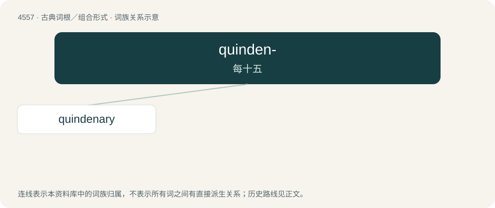

# 4557 · quinden- — 每十五

[总目录](../00_总目录_按常用程度.md)

**类型**：古典词根／组合形式　｜　**来源语言**：拉丁语

## 核心含义与来源

- 核心含义：每十五
- 英文含义：fifteen each
- 词形：quinden-

**来源词形**：quindeni

## 词族图

## 单词速览（常用到不常用）

| 单词 | 音标 | 释义 |
|---|---|---|
| [quindenary](#w-1) | /ˈkwind(ə)nəri/ | 十五进制的 |

## 逐词详解

### 1. quindenary

**词性**：形容词　｜　**音标**：/ˈkwind(ə)nəri/

**中文释义**：十五进制的

**英文义项**：Containing fifteen things, or to the base of fifteen.

**构词拆分**：quindene + -ary

**词源与演化**：

From Latin quindēnārius (“containing fifteen”). Equivalent to quindene + -ary.
