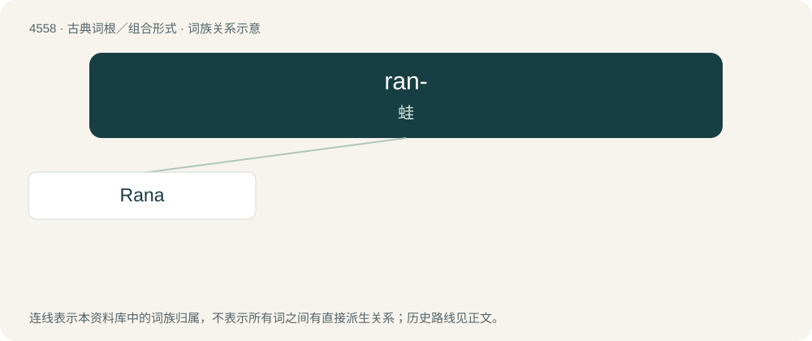

# 4558 · ran- — 蛙

[总目录](../00_总目录_按常用程度.md)

**类型**：古典词根／组合形式　｜　**来源语言**：拉丁语

## 核心含义与来源

- 核心含义：蛙
- 英文含义：frog
- 词形：ran-

**来源词形**：rāna

## 词族图

## 单词速览（常用到不常用）

| 单词 | 音标 | 释义 |
|---|---|---|
| [Rana](#w-1) |  | \[医\] 蛙属 |

## 逐词详解

### 1. Rana

**词性**：专有名词

**中文释义**：\[医\] 蛙属

**英文义项**：A surname. / A large municipality in Nordland county, Norway. See Rana, Norway on Wikipedia.Wikipedia

**词源与演化**：

Various origins of surname: \* Borrowed from Hindi राना (rānā)/राणा (rāṇā), a Rajput surname which probably is a back-formation from रानी (rānī, “queen”). \* Borrowed from Italian and Spanish Rana, a nickname for someone with bulging eyes or a croaky voice, from rana (“frog”). \* Borrowed from Galician Raña, a habitational surname from a village in the province of A Coruña.
