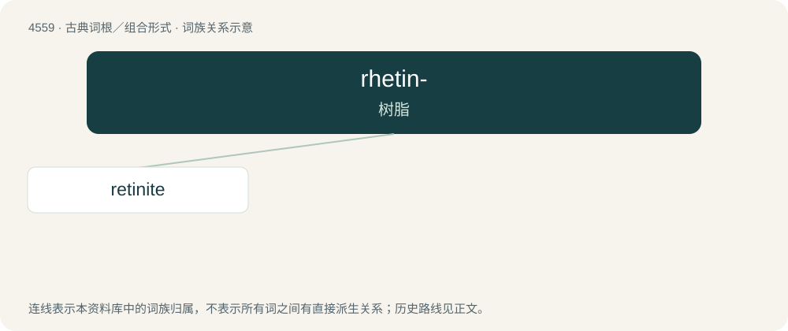

# 4559 · rhetin- — 树脂

[总目录](../00_总目录_按常用程度.md)

**类型**：古典词根／组合形式　｜　**来源语言**：古希腊语

## 核心含义与来源

- 核心含义：树脂
- 英文含义：resin
- 词形：rhetin-

**来源词形**：ῥητίνη (rhētínē), ῥητινώδης, ῥητινόω

## 词族图

## 单词速览（常用到不常用）

| 单词 | 音标 | 释义 |
|---|---|---|
| [retinite](#w-1) | /ˈretinait/ | n. \[矿\] 树脂石 |

## 逐词详解

### 1. retinite

**词性**：名词　｜　**音标**：/ˈretinait/

**中文释义**：n. \[矿\] 树脂石

**英文义项**：Any of various resins, similar in appearance to amber, associated with brown coal.
