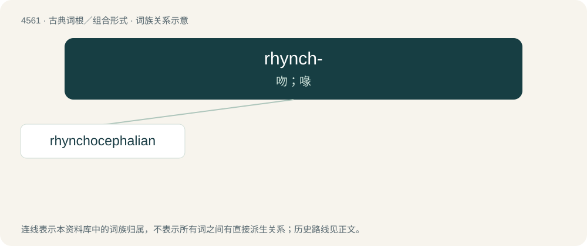

# 4561 · rhynch- — 吻；喙

[总目录](../00_总目录_按常用程度.md)

**类型**：古典词根／组合形式　｜　**来源语言**：古希腊语

## 核心含义与来源

- 核心含义：吻；喙
- 英文含义：snout
- 词形：rhynch-

**来源词形**：ῥύγχος (rhúnkhos)

## 词族图

## 单词速览（常用到不常用）

| 单词 | 音标 | 释义 |
|---|---|---|
| [rhynchocephalian](#w-1) |  | 【英文】Any of a group of reptiles of the order Rhynchocephalia; a tuatara. |

## 逐词详解

### 1. rhynchocephalian

**词性**：名词

**英文义项**：Any of a group of reptiles of the order Rhynchocephalia; a tuatara.

**词源与演化**：

Rhynchocephalia + -an

## 其他候选词

- Oncorhynchus
- Rhynchobatus
- rhynchophore
