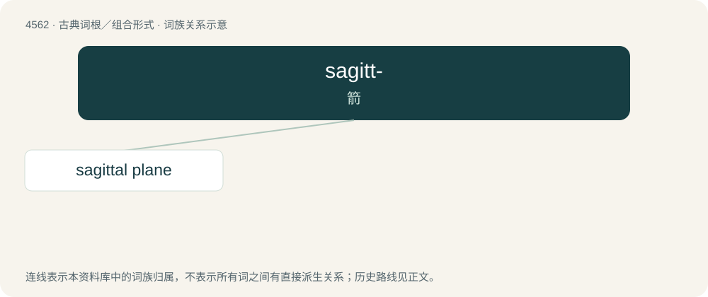

# 4562 · sagitt- — 箭

[总目录](../00_总目录_按常用程度.md)

**类型**：古典词根／组合形式　｜　**来源语言**：拉丁语

## 核心含义与来源

- 核心含义：箭
- 英文含义：arrow
- 词形：sagitt-

**来源词形**：sagitta

## 词族图

## 单词速览（常用到不常用）

| 单词 | 音标 | 释义 |
|---|---|---|
| [sagittal plane](#w-1) |  | \[医\] 矢状平面 |

## 逐词详解

### 1. sagittal plane

**词性**：名词

**中文释义**：\[医\] 矢状平面

**英文义项**：Any imaginary plane parallel to median plane.

**词源与演化**：

Calque of New Latin plānum sagittāle.

## 其他候选词

- Sagittaria
