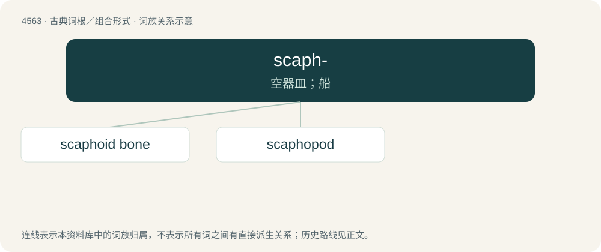

# 4563 · scaph- — 空器皿；船

[总目录](../00_总目录_按常用程度.md)

**类型**：古典词根／组合形式　｜　**来源语言**：古希腊语

## 核心含义与来源

- 核心含义：空器皿；船
- 英文含义：anything hollow, bowl, ship
- 词形：scaph-

**来源词形**：σκάφη, σκάφος

## 词族图

## 单词速览（常用到不常用）

| 单词 | 音标 | 释义 |
|---|---|---|
| [scaphoid bone](#w-1) |  | \[医\] 舟骨 |
| [scaphopod](#w-2) | /ˈskæfəpɔd/ | n. \[动\]掘足纲软体动物 |

## 逐词详解

### 1. scaphoid bone

**词性**：名词

**中文释义**：\[医\] 舟骨

**英文义项**：One of the carpal bones of the wrist.

### 2. scaphopod

**词性**：名词　｜　**音标**：/ˈskæfəpɔd/

**中文释义**：n. \[动\]掘足纲软体动物

**英文义项**：tusk shell

**词源与演化**：

From Ancient Greek σκάφος (skáphos, “boat”) + -pod.

## 其他候选词

- Scaphirhynchus
