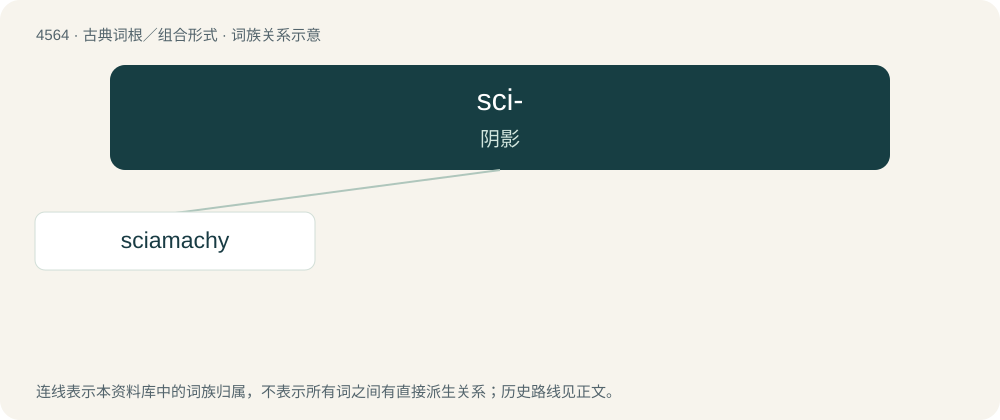

# 4564 · sci- — 阴影

[总目录](../00_总目录_按常用程度.md)

**类型**：古典词根／组合形式　｜　**来源语言**：古希腊语

## 核心含义与来源

- 核心含义：阴影
- 英文含义：shade, shadow
- 词形：sci-

**来源词形**：σκιά (skiá), σκιάς

## 词族图

## 单词速览（常用到不常用）

| 单词 | 音标 | 释义 |
|---|---|---|
| [sciamachy](#w-1) | 英 /sʌɪˈæməki/；美 /saɪˈæməki/ | n. 假想战 |

## 逐词详解

### 1. sciamachy

**词性**：名词　｜　**音标**：英 /sʌɪˈæməki/；美 /saɪˈæməki/

**中文释义**：n. 假想战

**英文义项**：shadow-boxing; fighting that is futile or make-believe

**词源与演化**：

From Late Latin sciamachia, and its source, Hellenistic Ancient Greek σκιαμαχία (skiamakhía), from σκιά (skiá, “shadow”) + μάχη (mákhē, “battle”).

## 其他候选词

- sciaphobia
