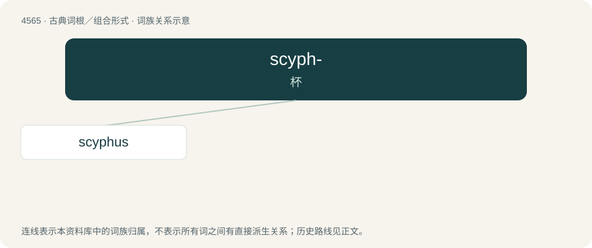

# 4565 · scyph- — 杯

[总目录](../00_总目录_按常用程度.md)

**类型**：古典词根／组合形式　｜　**来源语言**：古希腊语

## 核心含义与来源

- 核心含义：杯
- 英文含义：cup
- 词形：scyph-

**来源词形**：σκύφος (skúphos)

## 词族图

## 单词速览（常用到不常用）

| 单词 | 音标 | 释义 |
|---|---|---|
| [scyphus](#w-1) | /ˈsaifəs/ | (古希腊)双柄无脚杯 |

## 逐词详解

### 1. scyphus

**词性**：名词　｜　**音标**：/ˈsaifəs/

**中文释义**：(古希腊)双柄无脚杯

**英文义项**：A kind of large drinking cup used in Ancient Greece and Ancient Rome, especially by poor people. / The cup of a narcissus, or a similar appendage to the corolla in other flowers.

**词源与演化**：

Borrowed from Latin scyphus (“cup”), from Ancient Greek σκῠ́φος (skŭ́phos).

## 其他候选词

- scyphoid
- Scyphozoa
