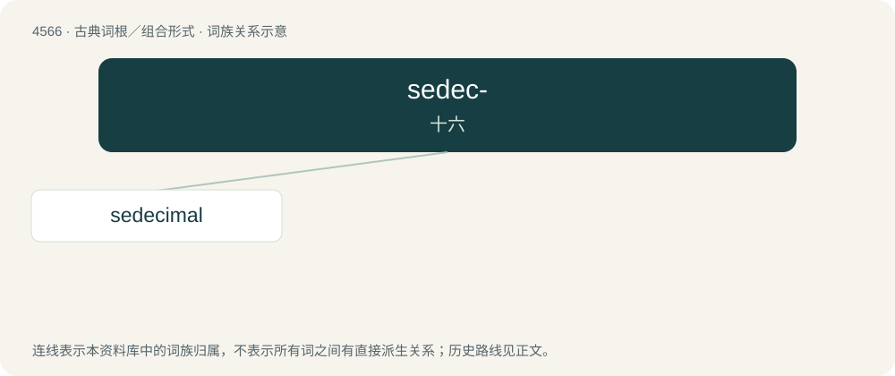

# 4566 · sedec- — 十六

[总目录](../00_总目录_按常用程度.md)

**类型**：古典词根／组合形式　｜　**来源语言**：拉丁语

## 核心含义与来源

- 核心含义：十六
- 英文含义：sixteen
- 词形：sedec-

**来源词形**：sedecim

## 词族图

## 单词速览（常用到不常用）

| 单词 | 音标 | 释义 |
|---|---|---|
| [sedecimal](#w-1) |  | 【英文】Pertaining to sixteen. |

## 逐词详解

### 1. sedecimal

**词性**：形容词

**英文义项**：Pertaining to sixteen. / Synonym of hexadecimal.

**词源与演化**：

From Latin sēdecim (“sixteen”) + -al, after decimal.
