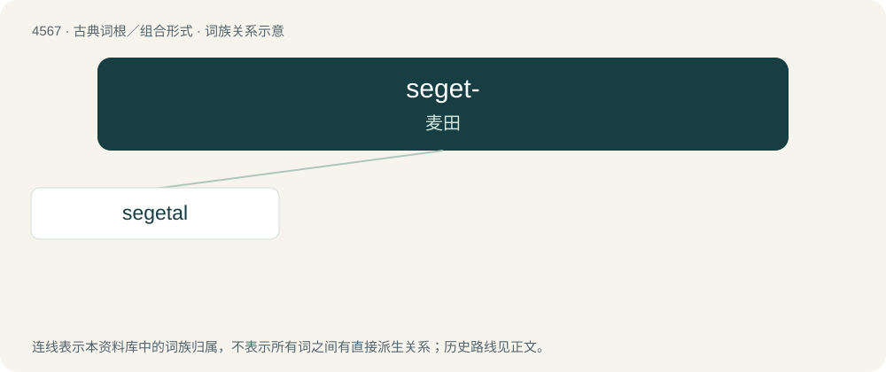

# 4567 · seget- — 麦田

[总目录](../00_总目录_按常用程度.md)

**类型**：古典词根／组合形式　｜　**来源语言**：拉丁语

## 核心含义与来源

- 核心含义：麦田
- 英文含义：in cornfields
- 词形：seget-

**来源词形**：segetum

## 词族图

## 单词速览（常用到不常用）

| 单词 | 音标 | 释义 |
|---|---|---|
| [segetal](#w-1) | /ˈsedʒətəl/ | a. 在谷类田间生长的 |

## 逐词详解

### 1. segetal

**词性**：形容词　｜　**音标**：/ˈsedʒətəl/

**中文释义**：a. 在谷类田间生长的

**英文义项**：That grows in cornfields.
