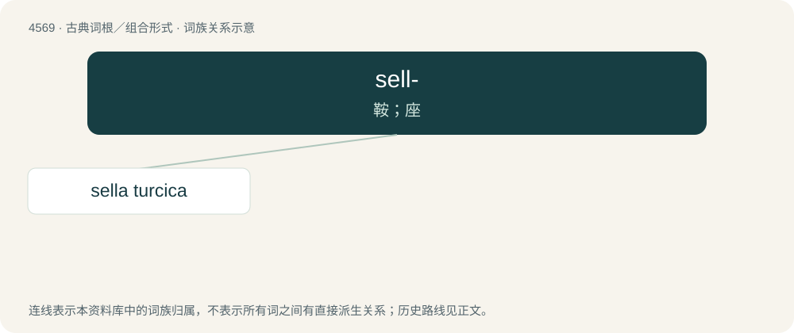

# 4569 · sell- — 鞍；座

[总目录](../00_总目录_按常用程度.md)

**类型**：古典词根／组合形式　｜　**来源语言**：拉丁语

## 核心含义与来源

- 核心含义：鞍；座
- 英文含义：saddle, seat
- 词形：sell-

**来源词形**：sella

## 词族图

## 单词速览（常用到不常用）

| 单词 | 音标 | 释义 |
|---|---|---|
| [sella turcica](#w-1) |  | \[医\] 蝶鞍 |

## 逐词详解

### 1. sella turcica

**词性**：名词

**中文释义**：\[医\] 蝶鞍

**英文义项**：A saddle-shaped depression in the sphenoid bone of the skull in humans and other hominids.

**词源与演化**：

Latin: sella + turcica = literally “Turkish chair”.
