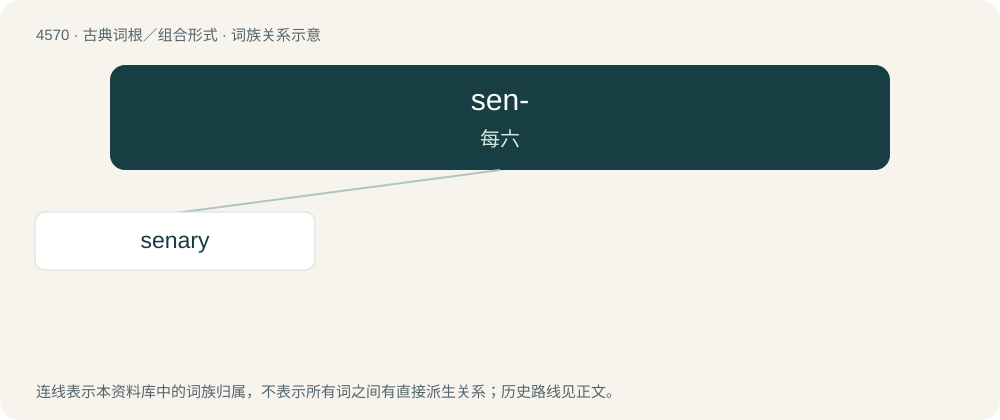

# 4570 · sen- — 每六

[总目录](../00_总目录_按常用程度.md)

**类型**：古典词根／组合形式　｜　**来源语言**：拉丁语

## 核心含义与来源

- 核心含义：每六
- 英文含义：six each
- 词形：sen-

**来源词形**：seni

## 词族图

## 单词速览（常用到不常用）

| 单词 | 音标 | 释义 |
|---|---|---|
| [senary](#w-1) | /ˈsiːnəɹi/ | a. 六的, 六进制的；\[计\] 六进制的 |

## 逐词详解

### 1. senary

**词性**：形容词　｜　**音标**：/ˈsiːnəɹi/

**中文释义**：a. 六的, 六进制的；\[计\] 六进制的

**英文义项**：Of sixth rank or order. / Of, pertaining to, or based on six.

**词源与演化**：

From the Latin sēnārius (“consisting of six each”), from sēnī (“six each, six at a time”) + -ārius (whence the English suffix -ary). Doublet of senarius.

**例句**：

> The senary fraction 0.2 is one-third, i.e. two-sixths.

该用例对应义项：Of, pertaining to, or based on six.
