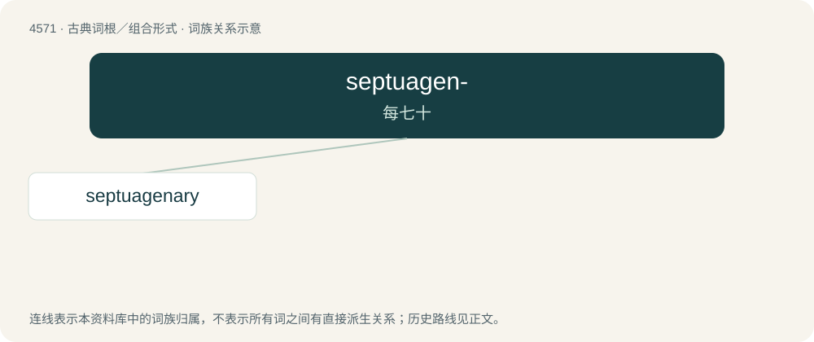

# 4571 · septuagen- — 每七十

[总目录](../00_总目录_按常用程度.md)

**类型**：古典词根／组合形式　｜　**来源语言**：拉丁语

## 核心含义与来源

- 核心含义：每七十
- 英文含义：seventy each
- 词形：septuagen-

**来源词形**：septuageni

## 词族图

## 单词速览（常用到不常用）

| 单词 | 音标 | 释义 |
|---|---|---|
| [septuagenary](#w-1) | 英 /ˌsɛptjʊəˈdʒiːnri/；美 /ˌsɛpt͡ʃəd͡ʒɛnəri/ | a. 七十几岁的 |

## 逐词详解

### 1. septuagenary

**词性**：形容词　｜　**音标**：英 /ˌsɛptjʊəˈdʒiːnri/；美 /ˌsɛpt͡ʃəd͡ʒɛnəri/

**中文释义**：a. 七十几岁的

**英文义项**：Of or related to the number seventy, particularly / Synonym of septuagenarian: lasting or aged seventy years; seventy-year-old.

**词源与演化**：

From Latin septuāgēnārius (“containing 70”) either directly or via French septuagénaire, from Latin septuāgēnus (“70 each”) + -ārius (“-ary”), from septuāgintā (“seven tens, 70”). Cognate with septuagenarian.
