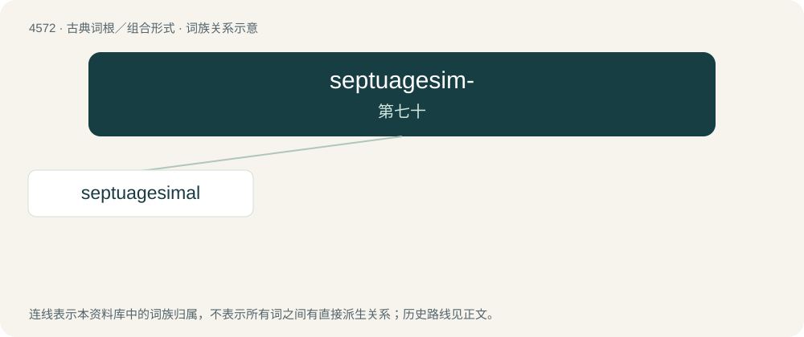

# 4572 · septuagesim- — 第七十

[总目录](../00_总目录_按常用程度.md)

**类型**：古典词根／组合形式　｜　**来源语言**：拉丁语

## 核心含义与来源

- 核心含义：第七十
- 英文含义：seventieth
- 词形：septuagesim-

**来源词形**：septuagesimus

## 词族图

## 单词速览（常用到不常用）

| 单词 | 音标 | 释义 |
|---|---|---|
| [septuagesimal](#w-1) | /ˌsɛptjuəˈd͡ʒɛsɪməl/ | 【英文】Consisting of seventy days, years, etc.; having seventy as a base. |

## 逐词详解

### 1. septuagesimal

**词性**：形容词　｜　**音标**：/ˌsɛptjuəˈd͡ʒɛsɪməl/

**英文义项**：Consisting of seventy days, years, etc.; having seventy as a base.

**用法示例／搭配（非完整句）**：

> septuagesimal pilgrimage

该用例对应义项：Consisting of seventy days, years, etc.; having seventy as a base.

## 其他候选词

- septuagesima
