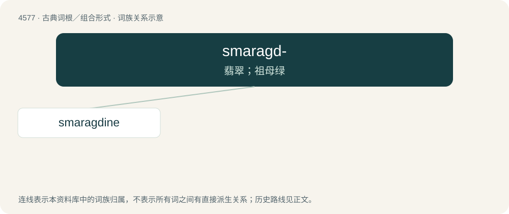

# 4577 · smaragd- — 翡翠；祖母绿

[总目录](../00_总目录_按常用程度.md)

**类型**：古典词根／组合形式　｜　**来源语言**：古希腊语

## 核心含义与来源

- 核心含义：翡翠；祖母绿
- 英文含义：emerald
- 词形：smaragd-

**来源词形**：σμάραγδος (smáragdos), σμαράγδινος (smarágdinos)

## 词族图

## 单词速览（常用到不常用）

| 单词 | 音标 | 释义 |
|---|---|---|
| [smaragdine](#w-1) | /sməˈɹæɡdiːn/ | a. 翡翠绿的,鲜绿色的 |

## 逐词详解

### 1. smaragdine

**词性**：名词　｜　**音标**：/sməˈɹæɡdiːn/

**中文释义**：a. 翡翠绿的,鲜绿色的

**英文义项**：Emerald.

**词源与演化**：

From Latin smaragdinus, from Ancient Greek σμάραγδινος (smáragdinos), from σμάραγδος (smáragdos). See emerald for more.
