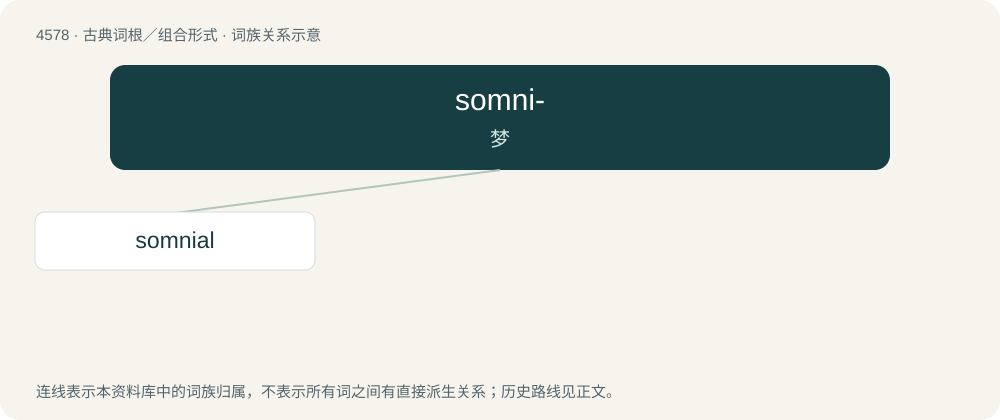

# 4578 · somni- — 梦

[总目录](../00_总目录_按常用程度.md)

**类型**：古典词根／组合形式　｜　**来源语言**：拉丁语

## 核心含义与来源

- 核心含义：梦
- 英文含义：dream
- 词形：somni-

**来源词形**：somnium

## 词族图

## 单词速览（常用到不常用）

| 单词 | 音标 | 释义 |
|---|---|---|
| [somnial](#w-1) | 英 /ˈsɒmnɪəl/ | a. 梦的,睡梦中的 |

## 逐词详解

### 1. somnial

**词性**：形容词　｜　**音标**：英 /ˈsɒmnɪəl/

**中文释义**：a. 梦的,睡梦中的

**英文义项**：Pertaining to dreams.

**词源与演化**：

From obsolete French somnial, from Latin somnialis, from somnium (“dream”).
