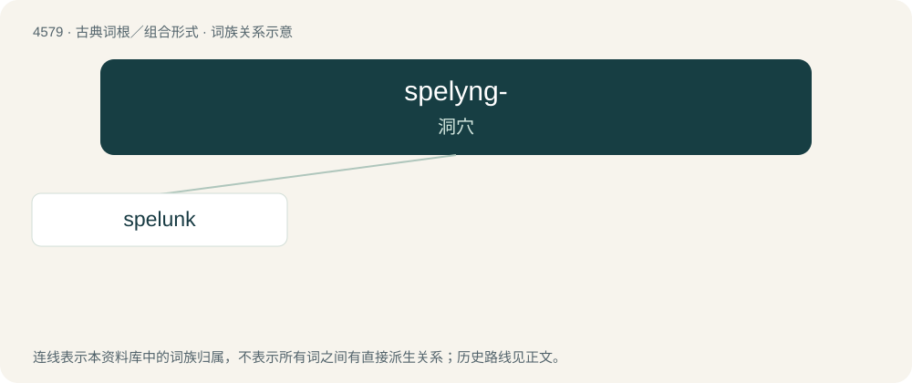

# 4579 · spelyng- — 洞穴

[总目录](../00_总目录_按常用程度.md)

**类型**：古典词根／组合形式　｜　**来源语言**：古希腊语

## 核心含义与来源

- 核心含义：洞穴
- 英文含义：cave
- 词形：spelyng-

**来源词形**：σπῆλυγξ, (spêlynx, spēlyng-)

## 词族图

## 单词速览（常用到不常用）

| 单词 | 音标 | 释义 |
|---|---|---|
| [spelunk](#w-1) | /spəˈlʌŋk/ | v. 洞穴探险, 洞穴研究 |

## 逐词详解

### 1. spelunk

**词性**：名词　｜　**音标**：/spəˈlʌŋk/

**中文释义**：v. 洞穴探险, 洞穴研究

**英文义项**：A cave, cavern or grotto.

**词源与演化**：

From Middle English spelunke, from Old French spelonque and/or Latin spelunca, from Ancient Greek σπῆλυγξ (spêlunx, “cave”), related to σπέος (spéos). Cognates include Middle Dutch spelunke, spelonke, German Spelunke.
