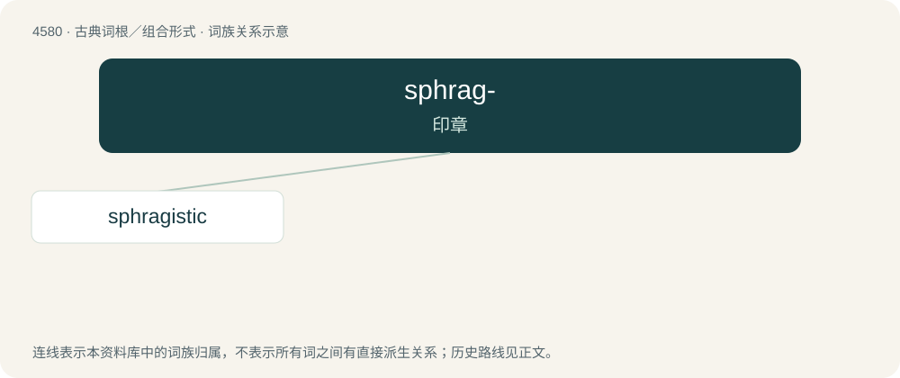

# 4580 · sphrag- — 印章

[总目录](../00_总目录_按常用程度.md)

**类型**：古典词根／组合形式　｜　**来源语言**：古希腊语

## 核心含义与来源

- 核心含义：印章
- 英文含义：seal
- 词形：sphrag-

**来源词形**：σφραγίς (sphragís), (sphragistikós), σφραγίζω

## 词族图

## 单词速览（常用到不常用）

| 单词 | 音标 | 释义 |
|---|---|---|
| [sphragistic](#w-1) |  | 【英文】Relating to sphragistics |

## 逐词详解

### 1. sphragistic

**词性**：形容词

**英文义项**：Relating to sphragistics
