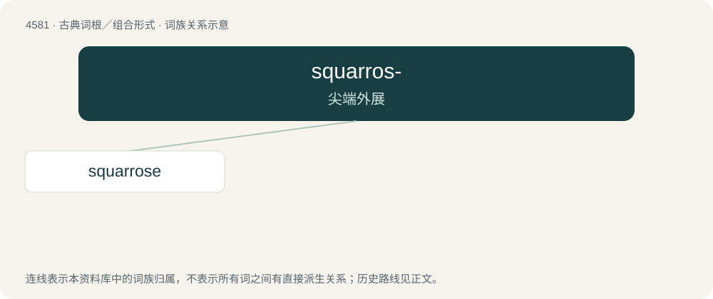

# 4581 · squarros- — 尖端外展

[总目录](../00_总目录_按常用程度.md)

**类型**：古典词根／组合形式　｜　**来源语言**：拉丁语

## 核心含义与来源

- 核心含义：尖端外展
- 英文含义：spreading at tips
- 词形：squarros-

**来源词形**：squarrosus

## 词族图

## 单词速览（常用到不常用）

| 单词 | 音标 | 释义 |
|---|---|---|
| [squarrose](#w-1) | /ˈskwærəus, ˈskwɔr-/ | a. 粗糙的, 多皮屑的；\[医\] 有头皮屑的 |

## 逐词详解

### 1. squarrose

**词性**：形容词　｜　**音标**：/ˈskwærəus, ˈskwɔr-/

**中文释义**：a. 粗糙的, 多皮屑的；\[医\] 有头皮屑的

**英文义项**：Rough or scaly. / Consisting of scales widely divaricating; having scales, small leaves, or other bodies, spreading widely from the axis on which they are crowded; said of a calyx or stem.

**词源与演化**：

From Latin squarrosus (“(perhaps) scurfy, scabby”).
