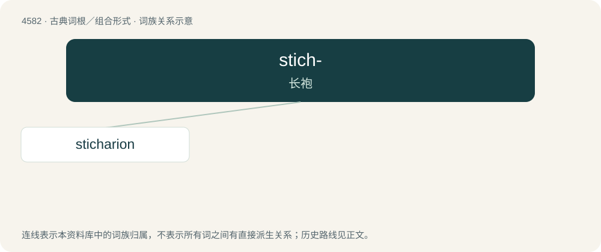

# 4582 · stich- — 长袍

[总目录](../00_总目录_按常用程度.md)

**类型**：古典词根／组合形式　｜　**来源语言**：古希腊语

## 核心含义与来源

- 核心含义：长袍
- 英文含义：tunic
- 词形：stich-

**来源词形**：στίχη (stíkhē), στιχάριον (stikhárion)

## 词族图

## 单词速览（常用到不常用）

| 单词 | 音标 | 释义 |
|---|---|---|
| [sticharion](#w-1) |  | 【英文】The outer clerical garb worn by clergy in the Greek Orthodox Church, corresponding to the alb in Latin-Rite Catholic Churches. |

## 逐词详解

### 1. sticharion

**词性**：名词

**英文义项**：The outer clerical garb worn by clergy in the Greek Orthodox Church, corresponding to the alb in Latin-Rite Catholic Churches.

**词源与演化**：

From Ancient Greek στιχάριον (stikhárion).
