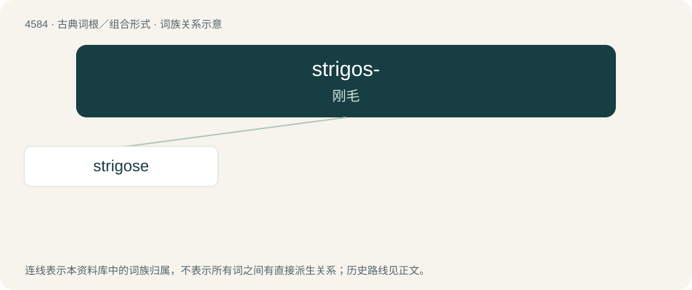

# 4584 · strigos- — 刚毛

[总目录](../00_总目录_按常用程度.md)

**类型**：古典词根／组合形式　｜　**来源语言**：拉丁语

## 核心含义与来源

- 核心含义：刚毛
- 英文含义：having stiff bristles
- 词形：strigos-

**来源词形**：strigosus from striga

## 词族图

## 单词速览（常用到不常用）

| 单词 | 音标 | 释义 |
|---|---|---|
| [strigose](#w-1) | /ˈstɹaɪɡəʊs/ | a. 有细密槽纹的 |

## 逐词详解

### 1. strigose

**词性**：形容词　｜　**音标**：/ˈstɹaɪɡəʊs/

**中文释义**：a. 有细密槽纹的

**英文义项**：Having fine grooves, ridges, or streaks. / Having stiff hairs, pressed together.

**词源与演化**：

From Latin striga (“row, strip, swath”) + -ose; compare strigosus.
