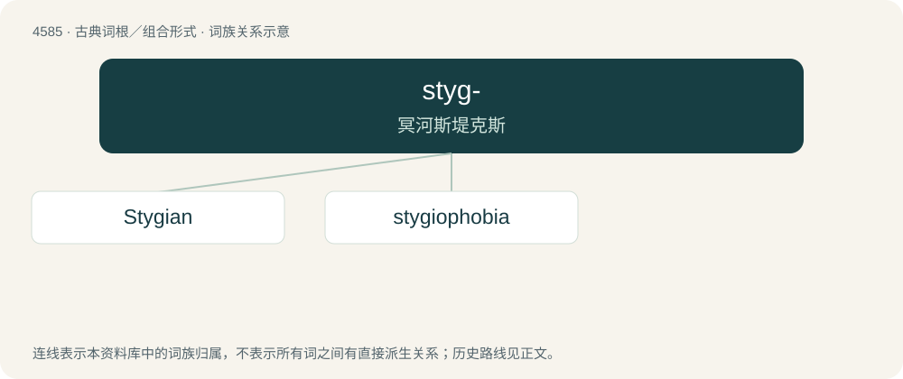

# 4585 · styg- — 冥河斯堤克斯

[总目录](../00_总目录_按常用程度.md)

**类型**：古典词根／组合形式　｜　**来源语言**：古希腊语

## 核心含义与来源

- 核心含义：冥河斯堤克斯
- 英文含义：Styx
- 词形：styg-

**来源词形**：Στύξ, Στυγός (Stúx, Stugós), Στύγιος

## 词族图

## 单词速览（常用到不常用）

| 单词 | 音标 | 释义 |
|---|---|---|
| [Stygian](#w-1) | 英 /ˈstɪd͡ʒiən/ | a. 冥河的, 阴森森的, 幽暗的, 不可侵犯的, 不可违背的 |
| [stygiophobia](#w-2) |  | 【英文】The fear of Hell. |

## 逐词详解

### 1. Stygian

**词性**：形容词　｜　**音标**：英 /ˈstɪd͡ʒiən/

**中文释义**：a. 冥河的, 阴森森的, 幽暗的, 不可侵犯的, 不可违背的

**英文义项**：Of, by or relating to the river Styx in Greek mythology. / Of, by or relating to the Plutonian moon named after Styx.

**词源与演化**：

See stygian.

**例句**：

> Heavenly ire / ne'er sent a pest more loathsome; ne'er were seen / worse plagues to issue from the Stygian mire.

### 2. stygiophobia

**词性**：名词

**英文义项**：The fear of Hell.

**词源与演化**：

From Latin stygius, from Ancient Greek Στύγιος (Stúgios, “relating to Styx”), and -phobia.
