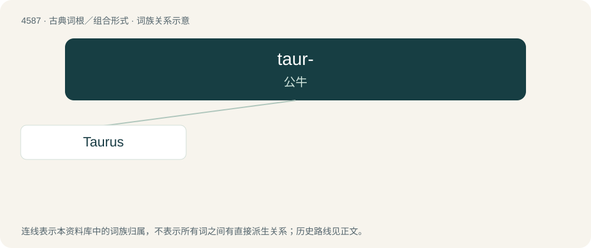

# 4587 · taur- — 公牛

[总目录](../00_总目录_按常用程度.md)

**类型**：古典词根／组合形式　｜　**来源语言**：拉丁语

## 核心含义与来源

- 核心含义：公牛
- 英文含义：bull
- 词形：taur-

**来源词形**：taurus

## 词族图

## 单词速览（常用到不常用）

| 单词 | 音标 | 释义 |
|---|---|---|
| [Taurus](#w-1) | 美 /ˈtɑɹəs/；/ˈtɔːɹəs/ | n. 金牛星座, 金牛宫 |

## 逐词详解

### 1. Taurus

**词性**：名词　｜　**音标**：美 /ˈtɑɹəs/；/ˈtɔːɹəs/

**中文释义**：n. 金牛星座, 金牛宫

**英文义项**：Someone with a Taurus star sign. / An automobile model produced by the Ford Motor Company (1986-present).

**词源与演化**：

From Latin Taurus (from taurus (“bull”)), from Ancient Greek Ταῦρος (Taûros) (compare Aramaic תּוֹר (tor), Arabic ثَوْر (ṯawr)), ultimately originating with Sumerian 𒄞𒀭𒈾 (GU₄.AN.NA, “Bull of Heaven; constellation Taurus”) . Latin taurus (“bull”) is a doublet of steer, tur, Tavros, and Tarvos.

**例句**：

> In Astrology, a person with a fixed sign such as Taurus is considered a reliable person.
