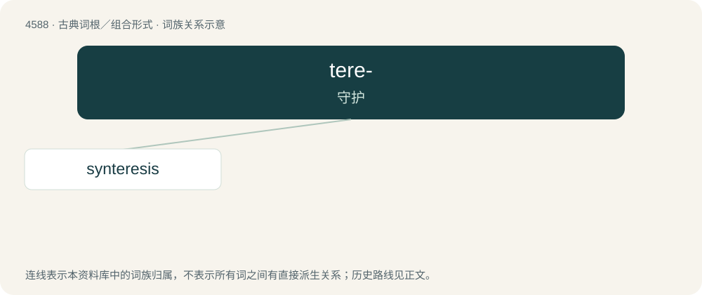

# 4588 · tere- — 守护

[总目录](../00_总目录_按常用程度.md)

**类型**：古典词根／组合形式　｜　**来源语言**：古希腊语

## 核心含义与来源

- 核心含义：守护
- 英文含义：guard
- 词形：tere-

**来源词形**：τηρεῖν (tēreîn), τήρησις (tḗrēsis)

## 词族图

## 单词速览（常用到不常用）

| 单词 | 音标 | 释义 |
|---|---|---|
| [synteresis](#w-1) | 英 /sɪntɪˈɹiːsɪs/ | \[医\] 预防 |

## 逐词详解

### 1. synteresis

**词性**：名词　｜　**音标**：英 /sɪntɪˈɹiːsɪs/

**中文释义**：\[医\] 预防

**英文义项**：An aspect of one's conscience by which one can judge wrong from right and decide on what makes good conduct (as distinguished from syneidesis). / Preventive treatment; prophylaxis.

**词源与演化**：

From Medieval Latin syntērēsis (in Thomas Aquinas), from Ancient Greek συντήρησις (suntḗrēsis, “careful watching”), from συντηρεῖν (suntēreîn, “to keep guard”).
