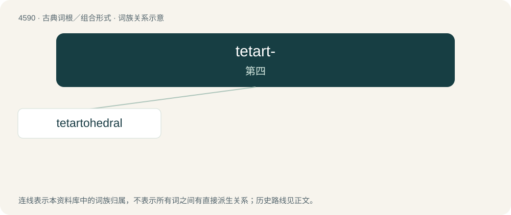

# 4590 · tetart- — 第四

[总目录](../00_总目录_按常用程度.md)

**类型**：古典词根／组合形式　｜　**来源语言**：古希腊语

## 核心含义与来源

- 核心含义：第四
- 英文含义：fourth
- 词形：tetart-

**来源词形**：τέταρτος (tétartos)

## 词族图

## 单词速览（常用到不常用）

| 单词 | 音标 | 释义 |
|---|---|---|
| [tetartohedral](#w-1) | /tiˈtɑːtəuˈhiːdrəl/ | a. 具有四分之一结晶体对称面的 |

## 逐词详解

### 1. tetartohedral

**词性**：形容词　｜　**音标**：/tiˈtɑːtəuˈhiːdrəl/

**中文释义**：a. 具有四分之一结晶体对称面的

**英文义项**：isometric and tetragonal, but having one fourth of the number of planes required for complete symmetry

**词源与演化**：

From Ancient Greek τέταρτος (tétartos) + -hedral.

## 其他候选词

- tetartanopsia
- tetartohedric
