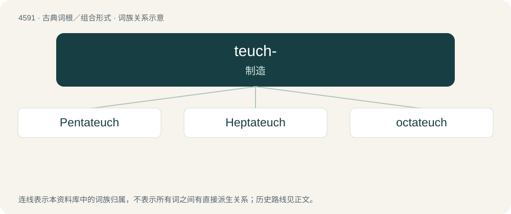

# 4591 · teuch- — 制造

[总目录](../00_总目录_按常用程度.md)

**类型**：古典词根／组合形式　｜　**来源语言**：古希腊语

## 核心含义与来源

- 核心含义：制造
- 英文含义：make
- 词形：teuch-

**来源词形**：τεύχειν (teúkhein), τυγχάνω, τευκτός, τευκτικός, τεῦξις (teûxis), τεῦγμα (teûgma), τεῦχος, τεύχεος (teûkhos, teúkheos), τύχη (túkhē), τυκτός (tuktós)

## 词族图

## 单词速览（常用到不常用）

| 单词 | 音标 | 释义 |
|---|---|---|
| [Pentateuch](#w-1) | 英 /ˈpɛntəˌtjuːk/；美 /ˈpɛntəˌtuk/ | n. &lt;&lt;摩西五经&gt;&gt; |
| [Heptateuch](#w-2) | /ˈheptətjuːk/ | n. &lt;&lt;圣经&gt;&gt;旧约的开首七卷 |
| [octateuch](#w-3) | 英 /ˈɒktətjuːk/ | 【英文】A collection of eight books; especially, the first eight books of the Old Testament. |

## 逐词详解

### 1. Pentateuch

**词性**：专有名词　｜　**音标**：英 /ˈpɛntəˌtjuːk/；美 /ˈpɛntəˌtuk/

**中文释义**：n. &lt;&lt;摩西五经&gt;&gt;

**英文义项**：Synonym of Torah.

**词源与演化**：

From Ancient Greek πεντάτευχος (pentáteukhos), from Ancient Greek πέντε (pénte, “five”) + τεῦχος (teûkhos, “tool, scroll, book”).

### 2. Heptateuch

**词性**：专有名词　｜　**音标**：/ˈheptətjuːk/

**中文释义**：n. &lt;&lt;圣经&gt;&gt;旧约的开首七卷

**英文义项**：The first seven books of the Hebrew Bible.

### 3. octateuch

**词性**：名词　｜　**音标**：英 /ˈɒktətjuːk/

**英文义项**：A collection of eight books; especially, the first eight books of the Old Testament.

**词源与演化**：

From the Late Latin octateuchus, from the Byzantine Greek ὀκτάτευχος \[βίβλος\] (oktáteukhos \[bíblos\], “\[a volume\] containing \[the first\] eight books \[of the Old Testament\]”), from the Ancient Greek ὀκτα- (okta-, “eight”, combining variant of ὀκτώ) + τεῦχος (teûkhos, “book”).
