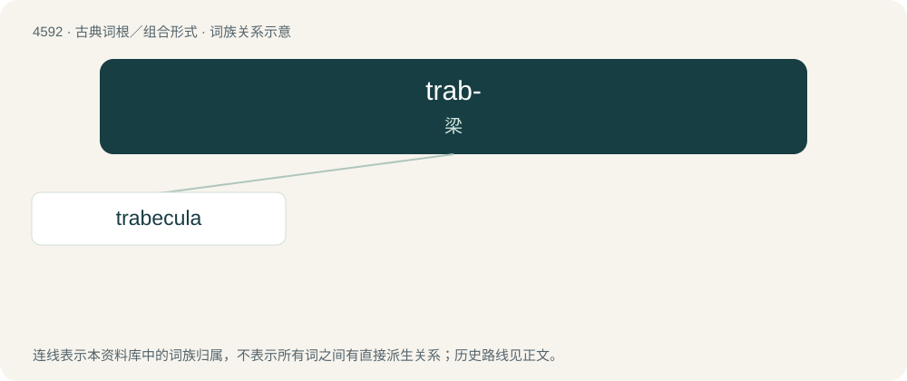

# 4592 · trab- — 梁

[总目录](../00_总目录_按常用程度.md)

**类型**：古典词根／组合形式　｜　**来源语言**：拉丁语

## 核心含义与来源

- 核心含义：梁
- 英文含义：beam
- 词形：trab-

**来源词形**：trabs, trabis

## 词族图

## 单词速览（常用到不常用）

| 单词 | 音标 | 释义 |
|---|---|---|
| [trabecula](#w-1) | /trəˈbɛkjʊlə/ | n. 小梁, 小柱, 横条；\[医\] 小梁, 柱 |

## 逐词详解

### 1. trabecula

**词性**：名词　｜　**音标**：/trəˈbɛkjʊlə/

**中文释义**：n. 小梁, 小柱, 横条；\[医\] 小梁, 柱

**英文义项**：A small supporting beam. / A small mineralized spicule that forms a network in spongy bone.

## 其他候选词

- trabeculae
