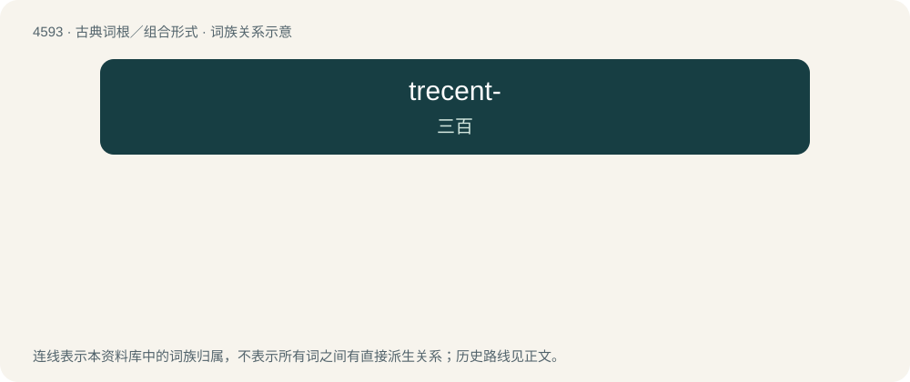

# 4593 · trecent- — 三百

[总目录](../00_总目录_按常用程度.md)

**类型**：古典词根／组合形式　｜　**来源语言**：拉丁语

## 核心含义与来源

- 核心含义：三百
- 英文含义：three hundred
- 词形：trecent-

**来源词形**：trecenti

## 词族图

## 其他候选词

- trecentennial
- trecentillion
