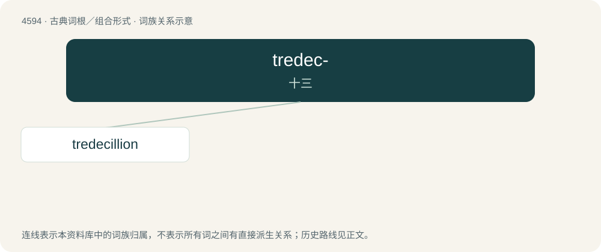

# 4594 · tredec- — 十三

[总目录](../00_总目录_按常用程度.md)

**类型**：古典词根／组合形式　｜　**来源语言**：拉丁语

## 核心含义与来源

- 核心含义：十三
- 英文含义：thirteen
- 词形：tredec-

**来源词形**：tredecim

## 词族图

## 单词速览（常用到不常用）

| 单词 | 音标 | 释义 |
|---|---|---|
| [tredecillion](#w-1) | /,triːdiˈsiljən/ | n. (pl.tredecillion, tredecillions)(在美、法)1后加42个0之数, (在英、德)1后加78个0之数；a. 上述数字的 |

## 逐词详解

### 1. tredecillion

**词性**：数词　｜　**音标**：/,triːdiˈsiljən/

**中文释义**：n. (pl.tredecillion, tredecillions)(在美、法)1后加42个0之数, (在英、德)1后加78个0之数；a. 上述数字的

**英文义项**：10⁴². / 10⁷⁸.

**词源与演化**：

From Latin trēdec(im) (“thirteen”) + -illion. By surface analysis, tre- + decillion.

## 其他候选词

- tredecimal
